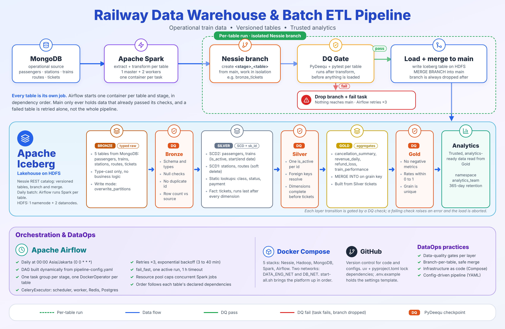
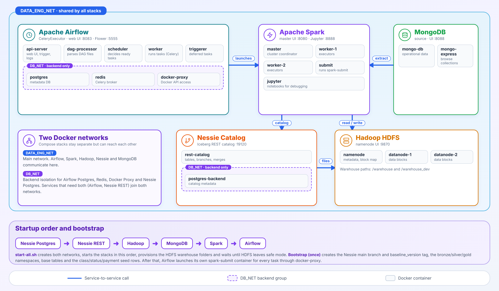
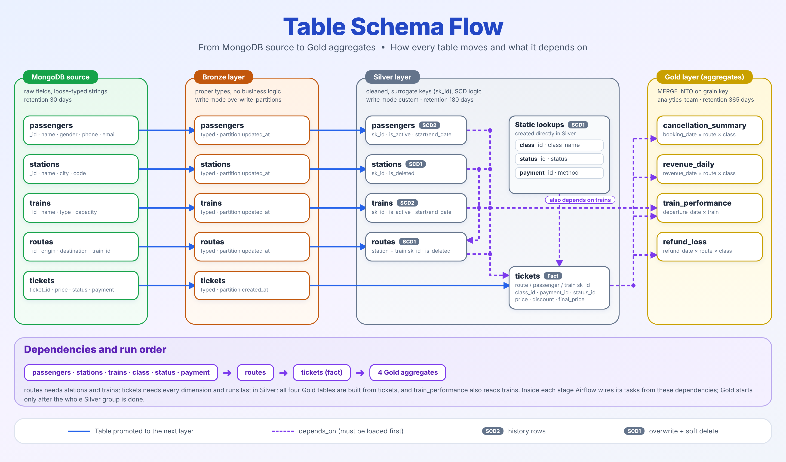
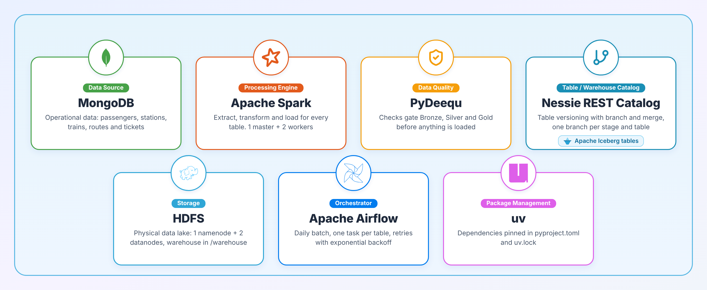
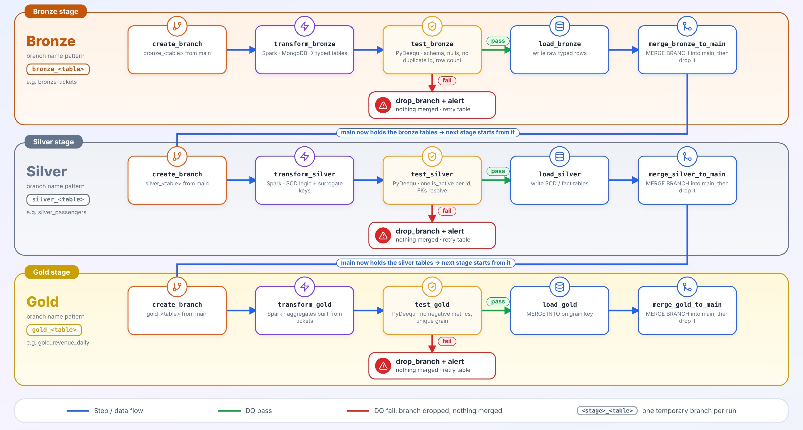

# Train Batch Pipeline

Batch data pipeline for processing train operational data (passengers, stations, trains, routes, and tickets) from operational sources into a data warehouse, using a **Medallion Architecture** (Bronze → Silver → Gold).

## Table of Contents

- [Architecture](#architecture)
- [Table Schema Flow](#table-schema-flow)
- [Tech Stack](#tech-stack)
- [Medallion Architecture](#medallion-architecture)
- [Nessie Branching Strategy](#nessie-branching-strategy)
- [Data Model](#data-model)
- [Project Structure](#project-structure)
- [Preview](#preview)
- [Installation & Running](#installation--running)
- [Contributing](#contributing)

## Architecture

### Pipeline Flow (logical)



1. **MongoDB** — raw operational data (source system).
2. **Airflow** — schedules and triggers jobs on a batch cadence.
3. **Spark** — extracts data from MongoDB, transforms it, and loads it into each layer (Bronze/Silver/Gold).
4. **Nessie REST Catalog** — manages the warehouse/table catalog (Iceberg-based) for table versioning and governance.
5. **HDFS** — the physical storage layer (data lake).

### Infrastructure / Deployment (Docker network)



All services run as separate Docker Compose stacks, but are joined into one overarching network, **`DATA_ENG_NET`**, so they can communicate across stacks. Each stack also has its own internal network (`*_NET`) for communication between containers within that stack.

| Stack       | Network                   | Container              | Role                                                                         |
| ----------- | ------------------------- | ---------------------- | ---------------------------------------------------------------------------- |
| **Airflow** | `DATA_ENG_NET` + `DB_NET` | Postgres               | Airflow metadata DB (DAG runs, task instances, variables, connections, XCom) |
|             |                           | Redis                  | Message broker for CeleryExecutor (task queue for workers)                   |
|             |                           | API Server             | Airflow Web UI (monitoring, triggering, logs)                                |
|             |                           | DAG Processor          | Parses DAG files and processes DAG definitions                               |
|             |                           | Scheduler              | Schedules DAG runs and determines which tasks are ready                      |
|             |                           | Worker                 | Executes Airflow tasks through CeleryExecutor                                |
|             |                           | Triggerer              | Runs deferred tasks and sensors asynchronously                               |
|             |                           | Docker Proxy           | Provides Docker API access for Airflow to create and manage containers       |
| **Spark**   | `DATA_ENG_NET`            | Master                 | Spark cluster coordinator                                                    |
|             |                           | Worker 1, Worker 2     | Runs Spark executors                                                         |
|             |                           | Submit                 | Client used to `spark-submit` Spark jobs from the pipeline/Airflow           |
|             |                           | Jupyter                | Notebook environment for ad-hoc exploration and debugging (`src/notebooks`)  |
| **Hadoop**  | `DATA_ENG_NET`            | Namenode               | HDFS metadata, directory structure, and block locations                      |
|             |                           | Datanode 1, Datanode 2 | Physical HDFS data block storage                                             |
| **Nessie**  | `DATA_ENG_NET` + `DB_NET` | REST Catalog           | Iceberg catalog for table management, branching, and versioning              |
|             |                           | Postgres Backend       | Persistent backend storage for Nessie metadata                               |
| **MongoDB** | `DATA_ENG_NET`            | MongoDB                | Operational data source for the pipeline                                     |
|             |                           | Mongo Express          | Web UI for browsing and inspecting MongoDB data                              |

### Network Architecture

The project uses two Docker networks:

* **`DATA_ENG_NET`**
  The primary application network used for communication between the data engineering services. Airflow, Spark, Hadoop, Nessie REST Catalog, and MongoDB are connected through this network so that the pipeline components can communicate with each other.

* **`DB_NET`**
  A dedicated backend network for database-related services. It is used by:

  * Airflow Postgres
  * Airflow Redis
  * Airflow Docker Proxy
  * Nessie Postgres Backend

### Why use two networks?

* **Service communication:** `DATA_ENG_NET` provides a shared network for the main data engineering components and allows Airflow to communicate with Spark, Hadoop, Nessie, and MongoDB.

* **Backend isolation:** `DB_NET` separates internal backend services such as Postgres, Redis, and Docker Proxy from the main data processing network.

* **Controlled connectivity:** Services that require both application-level communication and backend access can join both networks, while services that only need one type of communication remain on a single network.

* **Simpler architecture:** Using two networks avoids unnecessary network fragmentation while still providing logical separation between the data engineering layer and backend infrastructure.


## Table Schema Flow

How each table moves from **Source (MongoDB) → Bronze → Silver → Gold**, plus dependencies between tables (dashed lines).

`class`, `status`, and `payment` are small **static lookup dimensions** — created directly in the Silver layer (no Source/Bronze step) since they hold fixed reference values. `routes` depends on `stations` and `trains`, while `tickets` (fact table) depends on nearly every dimension and runs last among the Silver tables. The four **Gold** tables are aggregates on top of Silver — all depend on `tickets`, and `train_performance` also depends on `trains`.



## Tech Stack



## Medallion Architecture

- **Source** — raw representation of the MongoDB data structure (fields are typically loose-typed strings).
- **Bronze** — extracted from source with proper type casting, no business transformation. Write mode `overwrite_partitions`.
- **Silver** — cleaned, normalized data with surrogate keys (`sk_id`) and **SCD (Slowly Changing Dimension)** logic per table. Write mode `custom`. Also hosts static lookup dimensions (`class`, `status`, `payment`).
- **Gold** — business-level aggregates for reporting, built directly from Silver (mainly `tickets`). Write mode `custom` (`MERGE INTO` on a grain-specific key, e.g. `revenue_date + route_sk_id + class_id`). Owned by the `analytics_team` namespace, with 365-day retention.

Every layer transition (Bronze/Silver/Gold) is gated by a **DQ check** (see below).

### Gold tables

| Table | Grain | Contents |
|---|---|---|
| `cancellation_summary` | `booking_date` × `route_sk_id` × `class_id` | Cancellation counts/rate and lost revenue |
| `revenue_daily` | `revenue_date` × `route_sk_id` × `class_id` | Gross/net/refunded revenue, average ticket price |
| `refund_loss` | `refund_date` × `route_sk_id` × `class_id` | Refund volume, amounts, time-to-refund |
| `train_performance` | `departure_date` × `train_sk_id` | Occupancy, tickets sold/cancelled, revenue |

## Nessie Branching Strategy

A **per-stage, per-table** branching strategy: `<stage>_<table_name>` (e.g. `bronze_tickets`, `silver_passengers`).

**Why:** if one table fails to process or fails its DQ check, only that table/stage needs to be retried — not the entire pipeline.



DQ checks run as their **own Airflow task and image**, separate from the Spark load task — keeping load and validation independently retryable, and keeping the load image lighter.

- **Bronze DQ** — schema/type checks, null checks, no duplicate `id`, row count sanity vs. source.
- **Silver DQ** — SCD consistency (only one `is_active=true` per `id`), foreign keys resolve to valid dimension rows, referential completeness before `tickets` runs.
- **Gold DQ** — no negative/impossible metrics (`cancellation_rate`, `occupancy_rate` ∈ [0,1]), grain uniqueness, upstream Silver dependencies loaded successfully.

## Data Model

| Table | Type | Notes |
|---|---|---|
| `passengers` | SCD2 | History tracked via `is_active`, `start_date`, `end_date` |
| `stations` | SCD1 | Overwrite + `is_deleted` (soft delete) |
| `trains` | SCD2 | Same pattern as `passengers` |
| `routes` | SCD1 | Depends on `stations`, `trains`; soft delete |
| `class` | SCD1 (static) | Ticket class lookup (`id`, `class_name`) |
| `status` | SCD1 (static) | Ticket status lookup (`id`, `status`) |
| `payment` | SCD1 (static) | Payment method lookup (`id`, `method`) |
| `tickets` | Fact | Partitioned by `created_at`, full overwrite per load |
| `cancellation_summary` | Aggregate (Gold) | Depends on `tickets` |
| `revenue_daily` | Aggregate (Gold) | Depends on `tickets` |
| `refund_loss` | Aggregate (Gold) | Depends on `tickets` |
| `train_performance` | Aggregate (Gold) | Depends on `tickets`, `trains` |

> Full schema details and transform/merge queries are available in [`config/pipeline-config.yaml`](config/pipeline-config.yaml).

## Project Structure

```
.
├── airflow/dags/            # Airflow orchestration
├── config/                  # Pipeline schemas, dependencies, and filters
├── docker/                  # Per-service Compose stacks and build files
├── images/                  # Architecture and service screenshots
├── skills/                  # Repository-specific structure/refactor guidance
├── src/
│   ├── app/                  # Pipeline and bootstrap entry points
│   ├── core/                 # Configuration, registry, sessions, logging
│   ├── data_quality/        # PyDeequ checks by medallion stage
│   ├── etl/                  # Extract, transform, and load modules
│   ├── models/               # Pydantic configuration/result models
│   ├── notebooks/            # Jupyter notebooks mounted by Spark Jupyter
│   └── utils/                # Shared table, filter, text, and Nessie helpers
├── .env.example              # Environment template (no secrets)
├── pyproject.toml / uv.lock  # Package metadata and locked dependencies
├── requirements.txt          # pip installation fallback
└── start-all.sh / stop-all.sh
```

See [Project_Folders_Structure_Blueprint.md](Project_Folders_Structure_Blueprint.md) for directory responsibilities, entry points, naming conventions, extension templates, and deployment path constraints.

## Preview

<table>
  <tr>
    <td></td>
    <td></td>
    <td></td>
    <td></td>
    <td></td>
  </tr>
  <tr>
    <td align="center">Hadoop UI</td>
    <td align="center">Spark Master UI</td>
    <td align="center">Mongo UI</td>
    <td align="center">Airflow UI</td>
    <td align="center">Nessie Rest UI</td>
  </tr>
</table>

## Installation & Running

**Prerequisites:** Docker + Docker Compose, [`uv`](https://docs.astral.sh/uv/), and Python 3.7.1-3.10. The pinned NumPy and pandas versions do not support newer Python releases; Python 3.8 is recommended.

### 1. Clone Repository

```bash
git clone <repo-url>
cd train-batch-pipeline
```

### 2. Configure Environment

```bash
cp .env.example .env.global
export PROJECT_DIR="$(pwd)"
```

In Windows PowerShell, use:

```powershell
Copy-Item .env.example .env.global
$env:PROJECT_DIR = (Get-Location).Path
```

`PROJECT_DIR` is required — the Docker Compose stacks use it to resolve bind mounts (`src/`, `config/`, `.env.global`) and to build the host paths Airflow passes into each Spark task container. Adjust credentials, ports, and `START_DATE` / `END_DATE` in `.env.global` as needed.

### 3. Select Python and Install Dependencies

Check installed Python runtimes:

```bash
uv python list --only-installed
```

If Python 3.7 is already installed, create the project environment with it:

```bash
uv sync --python 3.7
```

If Python 3.7 is not installed, install and use Python 3.8 through `uv`:

```bash
uv python install 3.8
uv sync --python 3.8
```

Verify the environment with `uv run python --version`. Use Bash, Git Bash, or WSL for the startup scripts below; PowerShell can be used for the Python setup commands.

### 4. Start Services

```bash
source ./start-all.sh
```

The script creates the `db_net` and `data_eng_net` networks, then brings the stacks up in order: Nessie Postgres backend → Nessie REST Catalog → Hadoop → MongoDB → Spark → Airflow. It also provisions the HDFS warehouse directories (`/warehouse`, `/warehouse_dev`) and runs a safe-mode health check, leaving safe mode only when there are zero missing and zero corrupt blocks.

### 5. Initialize Pipeline

```bash
docker exec -it spark-submit \
    python -m src.app.run_pipeline --run_bootstrap

docker rm -f spark-submit
```

Bootstrap creates the Nessie `main` branch and `baseline_version` tag, the `bronze` / `silver` / `gold` namespaces, all base tables, and the seed rows for the static lookup dimensions (`class`, `status`, `payment`). The `spark-submit` container is removed afterwards because Airflow launches its own per-task containers under the same image.

### Service UIs

| Service | URL |
|---|---|
| Airflow | http://localhost:8083 |
| Spark Master | http://localhost:8080 |
| Hadoop Namenode | http://localhost:9870 |
| Nessie REST Catalog | http://localhost:19120 |
| Mongo Express | http://localhost:8088 |
| Jupyter | http://localhost:8888 |
| Flower (Celery) | http://localhost:5555 |


### Tearing Down

```bash
./stop-all.sh
```

> ⚠️ This stops every stack with `-v` and deletes the HDFS, Nessie, and MongoDB data directories. It prompts for confirmation first.

### CLI

| Flag | Env fallback | Required? | Description |
|---|---|---|---|
| `-stg` | — | Always | `bronze` \| `silver` \| `gold` |
| `-cfg` | `CONFIG_PATH` | Yes | Path to the pipeline config YAML |
| `-env` | `ENV_PATH` | Yes | Path to the env file (Mongo/Nessie/HDFS/Spark connections) |
| `-start` / `-end` | `START_DATE` / `END_DATE` | Yes (unless `--run_bootstrap`) | Run date range |
| `-tbl` | — | No | Specific table(s) (default: every table in that stage) |
| `--run_bootstrap` | — | No | Sets up Nessie branches/namespaces + base schemas |
| `--data_quality` | — | No | Runs PyDeequ DQ checks for the processed tables |

### Running the Pipeline

**Via Airflow (recommended):** enable the `Train_Batch_Pipeline` DAG in the Airflow UI. The DAG is built dynamically from `config/pipeline-config.yaml` — one task group per stage (Bronze → Silver → Gold), one `DockerOperator` task per table, wired together from each table's declared dependencies. It runs daily (`0 0 * * *`, Asia/Jakarta) with retries, exponential backoff, and a deadline alert.

**Manually in spark-submit container:**

```bash
python -m src.app.run_pipeline -stg silver \
  -cfg config/pipeline-config.yaml -env .env.global \
  -start 2024-03-22 -end 2024-03-23 \
  -tbl stations trains --data_quality
```